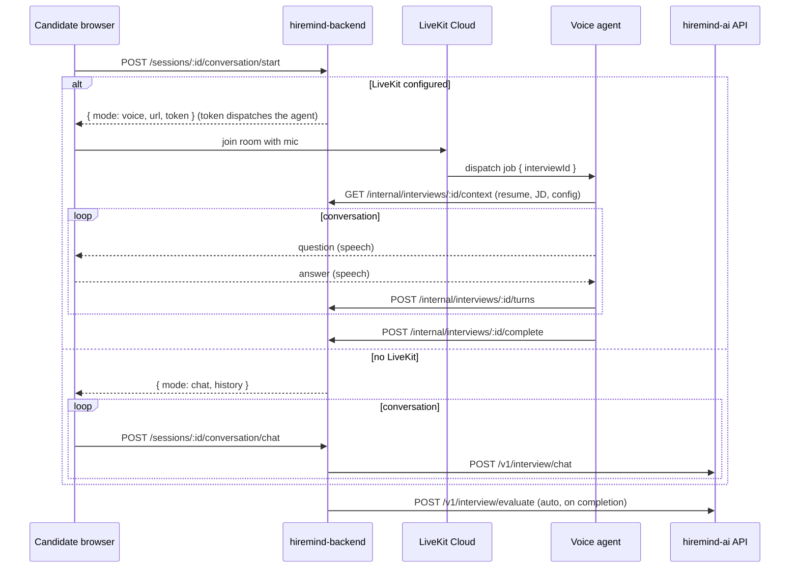

# hiremind-ai

The AI side of HireMind. It has two processes:

| Process | Command | What it does |
|---------|---------|--------------|
| **API** (FastAPI, :8000) | `uv run uvicorn app.main:app --port 8000` | Resume parsing, fit scoring, text-chat interview turns, interview evaluation. The backend calls it. |
| **Voice agent** (LiveKit) | `uv run python -m agent.worker dev` | Joins each candidate's LiveKit room and runs the spoken interview: STT → LLM → TTS (Cartesia speech, Gemini / Groq / Claude LLM). |

Both use the same interviewer prompt (`app/interviewer.py`). Before the first question, a **question plan** is built with retrieval (`app/rag.py`, `app/planner.py`):

1. The JD text, the uploaded JD file, the job's question-bank files and the candidate's resume are split into line-level chunks.
2. Each JD requirement is a query: BM25 pulls the best-matching resume lines and question-bank questions.
3. Claude turns those requirement → evidence pairs into an ordered plan of N questions, each with its source (`resume` / `jd` / `question_bank`), the evidence it is grounded in, and follow-ups. (Fake mode builds the plan from retrieval alone.)

The plan is saved on the interview (shown to recruiters) and the interviewer works through it, following up on vague answers.

### Integrity signals during the call

| Signal | Detected by | Severity |
|--------|-------------|----------|
| Camera off / covered | Browser: track state + frame brightness | strike |
| Face not visible | Browser: MediaPipe face detection | warning |
| Another person in frame | Browser: MediaPipe (2+ faces) | strike |
| Tab switch / focus loss / fullscreen exit / paste | Browser events | strike / warning |
| Mic muted for 8s+ | LiveKit track state | warning |
| Another voice, talking to someone, reading answers | The AI interviewer, from what it hears (`flag_integrity_concern` tool) | warning |

Events persist while the problem persists, so they are re-reported every 20 seconds. Strikes add up on the server, and 3 strikes end the interview. Serious events also reach the agent over the LiveKit data channel, so Tovia asks the candidate to fix them out loud.

### Audio and turn taking (ported from voice-bot-poc)

- **Noise suppression:** DTLN (`agent/dtln.py`, models in `models/dtln`) runs on the candidate's mic as a LiveKit frame processor at 16 kHz, before VAD, turn detection and STT. `NOISE_FILTER=false` turns it off.
- **VAD:** Silero with `VAD_START_SECS` / `VAD_STOP_SECS` / `VAD_CONFIDENCE`.
- **End of turn:** Cartesia `ink-2` uses its own STT turn detection. Other STTs use LiveKit's multilingual end-of-turn model (`TURN_DETECTOR`), which waits up to `ENDPOINTING_MAX_DELAY` while an answer sounds unfinished. Preemptive generation and VAD interruptions are on in both cases.
- **Fallbacks:** `LLM_FALLBACKS`, `STT_FALLBACKS`, `TTS_FALLBACKS` list providers to switch to when the primary errors (for example a Gemini 503). The API's plan, scoring and evaluation calls use the same LLM chain.
- **Drops:** if the candidate's connection drops, Tovia waits `REJOIN_GRACE_SECS` for them to rejoin and then picks up where she left off. Pressing "End interview" completes it immediately.

After changing the turn-detector setting or a fresh install, run `uv run python -m agent.worker download-files` again.

### Job knowledge base, guardrails and answer authenticity

- **Knowledge base (RAG per job):** documents a recruiter uploads on the job page ("Interview knowledge base": PDF, DOCX, TXT) feed the question plan, and during the call Tovia can look things up with the `search_job_knowledge` tool (BM25 over the JD and the uploaded documents, `agent/answer_watch.py`).
- **Guardrails** (`app/guardrails.py`): the prompt limits Tovia to the interview, and every candidate turn is also checked for prompt injection, questions about which AI/model she is, requests for answers or for their score, and off-topic requests. A match adds a note so the next reply declines and steers back, and records a `GUARD_*` event on the integrity timeline. Any sentence in which Tovia describes the model or vendor behind her is dropped before it is spoken or shown. Tovia never shares scores, assessments or expected answers.
- **Answer authenticity** (`app/authenticity.py`): each answer is scored for signs of being read out from an AI tool (written-style phrasing, "firstly/secondly" structure, no natural speech markers, a long pause before a long fluent answer, reading pace). A suspicious answer records `AI_SUSPECTED_READING` and Tovia asks a follow-up that needs a personal, specific detail. The evaluation adds an `authenticity` section (verdict, human likelihood, signals, flagged answers) shown on the recruiter's interview page. These are signals for review, not proof.

## How an interview flows



Every turn is saved as `InterviewQuestion` (AI) + `Answer` (candidate). Recruiters see the full conversation, live transcript, evaluation, strengths and concerns on the interview page.

## Setup

```bash
cd ai
uv sync                                        # installs Python 3.12 + deps
cp .env.example .env                           # then fill in keys (below)
uv run python -m agent.worker download-files   # VAD model for the voice agent, one-time
```

`JWT_INTERNAL_SECRET` must match the backend's. The two services authenticate to each other with short-lived JWTs signed with it.

### Keys

| Variable | Where to get it | Needed for |
|----------|-----------------|------------|
| `GEMINI_API_KEY` | aistudio.google.com → Get API key | With `LLM_PROVIDER=gemini` (default): real interviewer, question plan, fit scoring, evaluation. Without the chosen provider's key the service runs in **fake mode** with a scripted interviewer and fixed scores. |
| `GROQ_API_KEY` | console.groq.com → API keys | With `LLM_PROVIDER=groq`: `GROQ_MODEL` (default `openai/gpt-oss-120b`) for plan/scoring/evaluation, `GROQ_VOICE_MODEL` (default `openai/gpt-oss-20b`) for spoken turns. Also `STT_PROVIDER=groq` (Whisper large-v3-turbo). |
| `ANTHROPIC_API_KEY` | console.anthropic.com → API keys | Only with `LLM_PROVIDER=claude` |
| `CARTESIA_API_KEY` | play.cartesia.ai → API keys | Voice agent speech-to-text (`ink-whisper`) and text-to-speech (`sonic-3`). Change the voice with `CARTESIA_VOICE`. |
| `OPENAI_API_KEY` | platform.openai.com → API keys | Only if `STT_PROVIDER` or `TTS_PROVIDER` is set to `openai` |
| `LIVEKIT_URL`, `LIVEKIT_API_KEY`, `LIVEKIT_API_SECRET` | Local dev: `livekit-server --dev` gives `ws://localhost:7880`, `devkey`, `secret` (already set). Production: cloud.livekit.io → project → Settings → Keys | WebRTC video call. Use the same three values in the **backend** `.env`. |

The backend's `INTERVIEW_MODE=auto` offers the video call only when this service reports `voiceReady`: LiveKit plus the speech keys for the chosen providers. Without an LLM key the call still runs, but Tovia reads the RAG question plan as a fixed script (one question per answer, no follow-ups). Restart the API and the agent after changing `.env`. Until then, candidates get the chat interview. Set `voice` or `chat` to force a mode.

Models: `gemini-3.8-flash` (`GEMINI_MODEL`; voice turns use minimal thinking) or `claude-opus-5-5` (`CLAUDE_MODEL`). Voice turns run at low effort for fast replies. Evaluation runs at high effort. Requests opt into server-side refusal fallback (`fallbacks: "default"`).

## Run everything locally

```bash
# 0. WebRTC server (dev)
livekit-server --dev
# 1. backend (repo root) — set AI_FAKE_MODE=false so it calls this service for parsing/scoring/evaluation
npm run start:dev
# 2. AI API
cd ai && uv run uvicorn app.main:app --port 8000
# 3. voice agent (needs LiveKit + CARTESIA_API_KEY; GEMINI_API_KEY for the real interviewer)
cd ai && uv run python -m agent.worker dev
# 4. frontend
cd frontend && npm run dev
```

## Tests

```bash
uv run pytest
```
